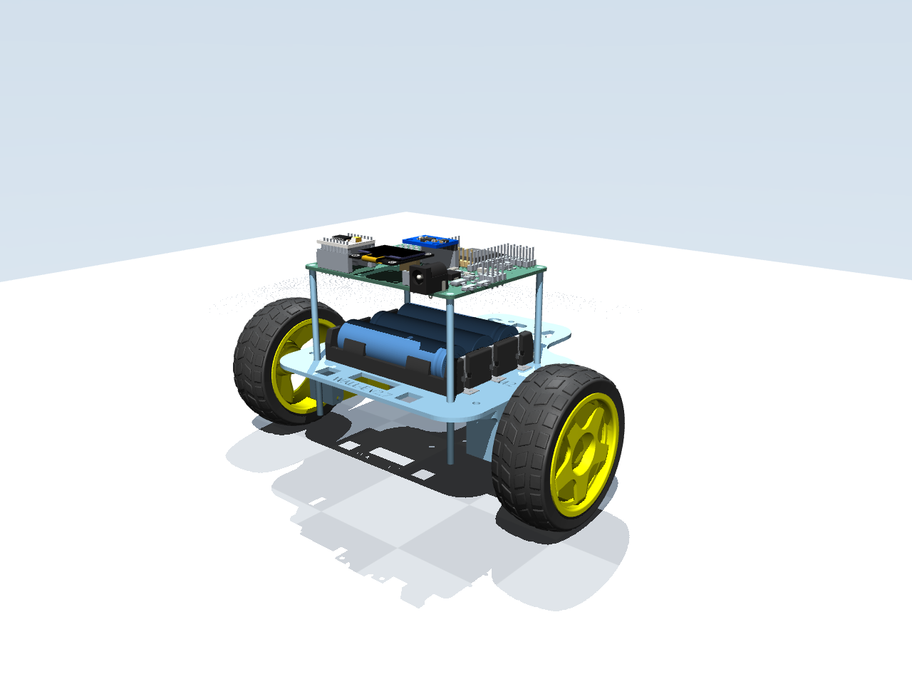

# RoboBalance

**From a CAD assembly and a CartPole lesson to a two-wheeled robot learning to stay near one spot in MuJoCo.**

<p align="center">
  
</p>

This is a learning and engineering project for a self-balancing Wall-E robot. The repository keeps the CAD import, mass and inertia audit, MuJoCo model, simulated IMU and motor response, Gymnasium task, PPO training, and evaluation separate so each result can be checked. **The learned result is simulation-only.** The current policy uses wheel speed and axle position from MuJoCo; the physical TT motors have no encoders, so that policy is not ready for the ESP32.

## Where it stands

| Milestone | Result | Evidence |
| --- | --- | --- |
| Learn PPO on CartPole | 100,000-step seeded training run; independent evaluation reached the 500-step cap in all 30 episodes | [CartPole result](docs/PHASE1_RESULT.md) and [walkthrough](docs/CARTPOLE_GYMNASIUM.md) |
| Import Wall-E geometry | Active `Assembly 1` URDF and meshes converted into a recognizable MuJoCo scene | [Import report](simulation/IMPORT_REPORT.md) |
| Audit mass and dynamics | Structural, battery, screw, PCB, motor, and wheel assignments recorded; articulated model has a free chassis and two wheel hinges | [Mass/COM](simulation/MASS_AND_COM_REPORT.md) and [dynamic model](simulation/DYNAMIC_MODEL_REPORT.md) |
| Build the control loop | Simulated MPU6050-style readings and an image-derived N20 motor curve drive two torque actuators | [Simulation guide](simulation/README.md) |
| Train station keeping | PPO checkpoint selected at 114,688 steps; 20 fresh 60-second simulation episodes survived and passed the chosen station-keeping criteria | [Evaluation JSON](experiments/wall_e_ppo/seed42042_20261013T215415483354Z/best_60s_evaluation.json) |

The selected policy's **maximum axle excursion was 4.30 cm** across those 20 episodes; its worst settled RMS forward speed was **1.79 cm/s**. The criteria were 5 cm and 2 cm/s, plus a 2° settled pitch-error limit. These are task tolerances in one provisional simulated model, not measurements of physical balance. The final checkpoint from the same training run drifted farther, so examples below use the validation-best checkpoint.

## How the pieces connect

```text
CAD URDF + meshes ──> mass/inertia audit ──> MuJoCo balance model
                                               │
                              simulated IMU + motor response
                                               │
                   Gymnasium reset / observation / reward / step
                                               │
                          PPO training ──> saved policy
                                               │
                      fresh-seed evaluation and viewer
```

The stationary task gives PPO six scaled observations: fused IMU pitch error and rate, left and right wheel speeds, axle displacement from the start, and forward speed. One action in `[-1, 1]` becomes a shared signed PWM command, limited to 40% in the current experiment. The motor model updates wheel torque every MuJoCo physics step while PPO holds its command for 10 ms. Each step returns the next observation and a bounded reward that favors staying upright, close to the start, and nearly still. [The environment code](environments/wall_e_balance_env.py) is the best place to follow one complete action.

## Run it

Use Python 3.10 or newer from the repository root:

```bash
python3 -m venv .venv
.venv/bin/python -m pip install --upgrade pip
.venv/bin/python -m pip install -e '.[test]'
.venv/bin/python -m pip install -r simulation/requirements-preview.txt
.venv/bin/python -m pytest -q
```

Inspect the CAD assembly without dynamics:

```bash
.venv/bin/python -m simulation.preview
```

Evaluate the included PPO checkpoint headlessly on new randomized starting pitches:

```bash
.venv/bin/python -m training.evaluate_wall_e_ppo \
  experiments/wall_e_ppo/seed42042_20261013T215415483354Z/best/best_model.zip \
  --config configs/wall_e_stationary_ppo.yaml \
  --episodes 20 --seconds 60 --seed 50000
```

Add `--viewer` to watch an episode; `--playback-speed 2` shows it at twice normal playback speed without changing the simulated physics. The default reset randomizes pitch between **29.5° and 35.5°** around the wheel axle. `--seed` makes that sequence repeatable. The evaluator saves survival, fall rate, pitch, speed, travel, reward, and station-keeping results as JSON.

Train a **new** Wall-E PPO policy:

```bash
.venv/bin/python -m training.train_wall_e_ppo \
  --config configs/wall_e_stationary_ppo.yaml
```

Each training command starts fresh and writes its own directory under `experiments/` with the resolved config, seeds, dependency versions, source hashes, checkpoints, TensorBoard logs, and independent evaluation. For a quick software check, add `--timesteps 256`; that short run is not a balance result. `training/train.py` remains the separate CartPole lesson.

## The project journey

1. **Learn the loop.** CartPole established the observation → action → reward → PPO update cycle with seeded training and separate evaluation. The [beginner walkthrough](docs/CARTPOLE_GYMNASIUM.md) and [RL glossary](docs/RL_GLOSSARY.pdf) start here.
2. **Bring in the assembly.** The active Onshape-derived `Assembly 1/` export contains the URDF and visual meshes. Converters preserve component placement and produce a static preview before any claim about dynamics.
3. **Make mass assumptions explicit.** The audit applies the user's corrected component masses and distinguishes custom inspection metadata from MuJoCo inertial properties. The articulated model is CAD-derived and provisional.
4. **Wire up sensing and actuation.** A simulated MPU6050-style estimate, signed PWM-to-torque map, wheel hinges, and floor contacts make software control experiments possible. PID diagnostics exposed balance-reference and motor-model problems; their logs are local experiment data rather than proof of hardware behavior.
5. **Train for staying put.** An early survival-only PPO policy remained upright while driving about 3 m in 30 s. The later stationary task added a position reference and speed penalty. Its selected policy stays within centimeters in held-out simulation episodes, while later training shows that more updates can make a policy worse.

## What is still unproven

The active mass model uses CAD, screenshot-derived inertia, corrected component weights, and assumptions about material distribution. Motor endpoints came from a supplied N20 specification image, while the assembled motor response, polarity, friction, contact, IMU balance-pose calibration, and full robot mass have not been validated against hardware. There are no wheel encoders on the physical TT motors, so the simulator's wheel-speed and position observations would require a real measurement or validated estimator before deployment. No PPO policy is flashed to the robot; safety cutoffs belong outside any learned policy.

## Find your way around

| Path | Purpose |
| --- | --- |
| `Assembly 1/` | Active URDF and meshes needed by the MuJoCo scenes |
| `simulation/` | Model builders, generated XMLs, sensor/motor code, diagnostics, and verification |
| `environments/` | Gymnasium interface used by Wall-E PPO |
| `training/` | Separate CartPole and Wall-E training/evaluation commands |
| `configs/` | Experiment settings and declared assumptions |
| `docs/` | Learning guides, hardware notes, project plan, and audit references |
| `tests/` | Focused checks for model, motor, and environment behavior |

The complete [project map](docs/PROJECT_MAP.md), [plan](docs/PLAN.md), [hardware notes](docs/HARDWARE.md), and [reading path](papers/README.md) record the details and next measurements. Most generated runs, older CAD exports, and local reading copies are intentionally outside Git; the selected checkpoint and evaluation above are included as a compact example.
